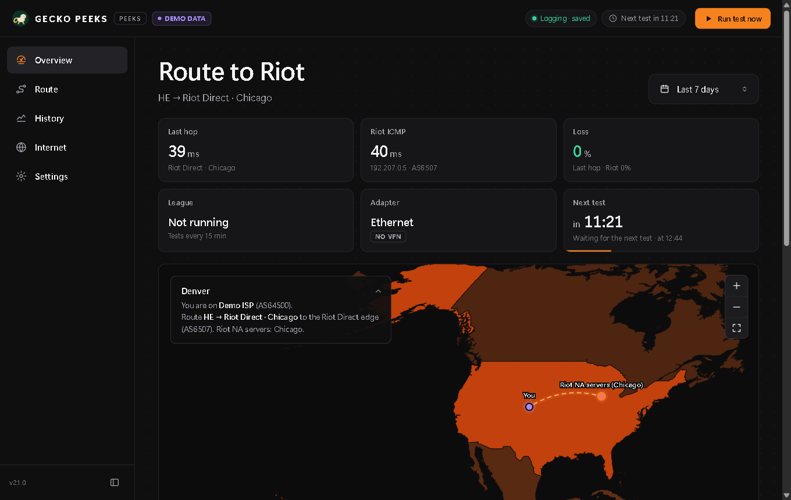
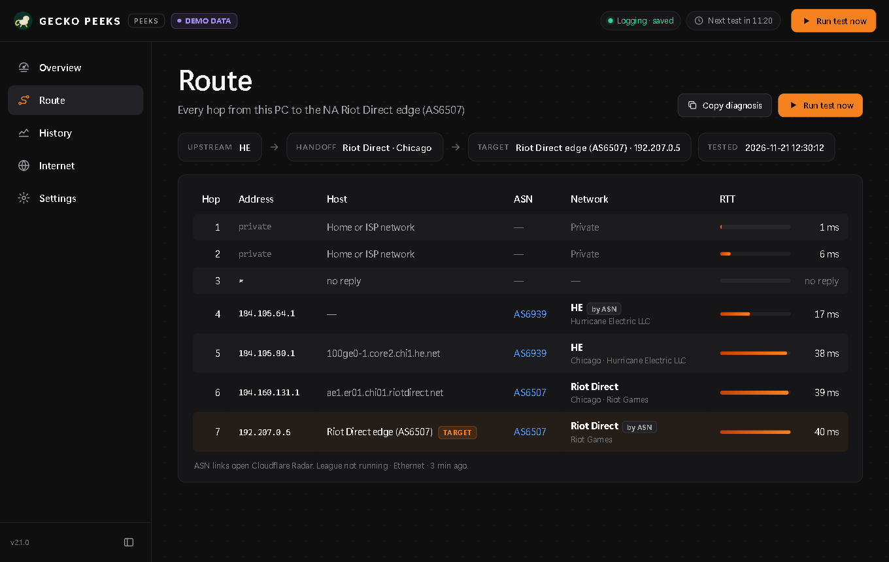
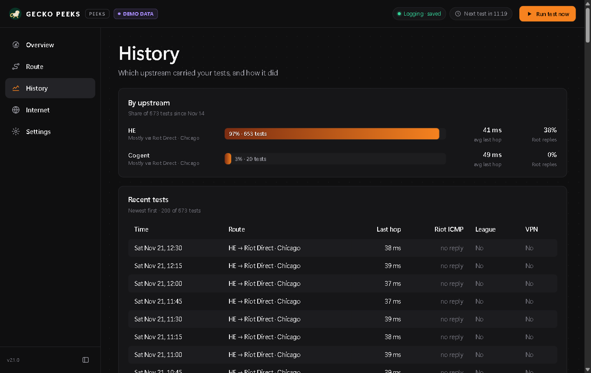
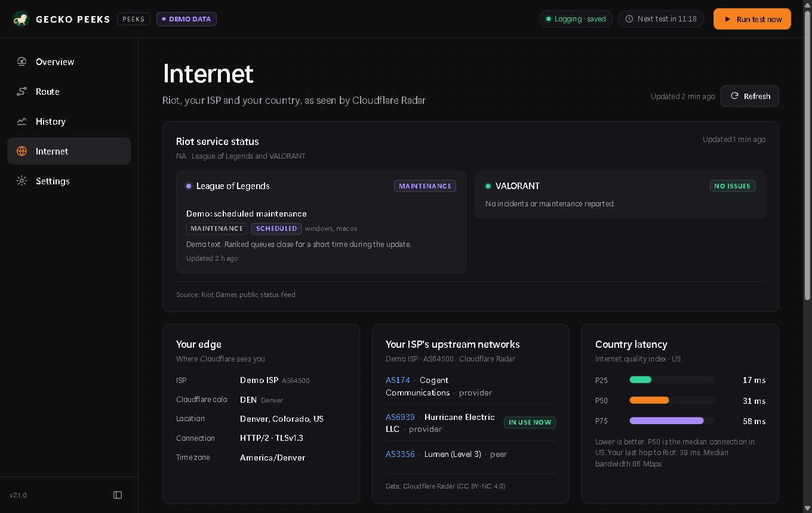

# Gecko Peeks

Gecko Peeks is a small Windows tray app. It watches the network route from your PC to Riot Games.

Every 15 minutes it runs a traceroute and a ping to the Riot target for your region. While a League of Legends game runs, it tests every 5 minutes. It names the networks on the route, logs every test to a CSV file, and tells you when the route changes.



*All screenshots use the built-in demo data. They do not show a real connection.*

## What it does

- **Traces the route to Riot.** Each test is an ICMP traceroute (3 probes per hop, up to 25 hops) to the Riot target for your region. Then it measures the last router before the target and the target itself, with 10 pings each.
- **Names the networks.** It names the **upstream** (the transit network that carries you toward Riot) and the **handoff** (where the route enters the next network, with its city). It reads router host names. With Cloudflare live data on, it also uses the ASN when a host name does not say the network.
- **Alerts on a route change.** A tray notification shows when the upstream or the handoff city changes. Two tests in a row must agree first, so one odd test does not cause an alert.
- **Keeps a log.** Each finished test is one row in a CSV file that you can open in Excel.
- **Shows live data (on by default).** **Cloudflare live data** shows Riot's service status for League of Legends and VALORANT, and Cloudflare Radar data about Riot, your ISP and your country. It also helps to name routers. See [Privacy](#privacy) for what it sends.
- **Works for any Riot region.** 15 regions are listed (NA, EUW, EUNE, KR, JP, BR, LAN, LAS, OCE, TR, RU, ME, SEA, TW, VN). With Cloudflare live data on, the app picks your region from your country. You can also pick it in Settings. Otherwise it uses NA.
- **Updates itself.** New versions download in the background and install when you are not playing. See [How auto-update works](#how-auto-update-works).

### About the Riot target

For NA and most other regions, the target is `192.207.0.5`. This address is Riot Direct's anycast edge (AS6507). It is the nearest Riot Direct router, not the game server. EUW and KR use a Riot platform address in the region.

Riot drops ping on many paths. When no ping comes back, the app shows **no reply** for Riot ICMP. This is normal. The **Last hop** number is then the useful one: it is the round trip to the last router that answered before Riot.

The 5-minute rate starts when the game process (`League of Legends.exe`) runs. The League client alone does not change the rate.

## Screenshots

| Route | History | Internet |
|---|---|---|
|  |  |  |

- **Overview**: the route, Last hop, Riot ICMP, loss, League, adapter, the next test, a map, a latency chart (24 hours, 7, 30 or 90 days, or all tests), an Internet pulse and Riot status.
- **Route**: every hop with its address, host name, ASN, network and round trip. A changed hop is marked.
- **History**: which upstream carried your tests and how each did, and your tests, newest first, with **Show 200 more**.
- **Internet**: Riot service status, where Cloudflare sees you, your ISP's upstream networks, country latency, traffic and events from Cloudflare Radar.
- **Settings**: region, Start with Windows, Install updates automatically, Cloudflare live data, the log, and the version.

## Install

You need Windows 11 (x64). The app uses the Microsoft Edge WebView2 Runtime, which Windows 11 includes. It does not need administrator rights.

1. Download `GeckoPeeks.exe` from the [Releases page](https://github.com/gecko-of-shadow/gecko-peeks-app/releases).
2. Make the folder `%LOCALAPPDATA%\Programs\GeckoPeeks` and put the exe in it.
3. Run the exe. The window opens, and the gecko icon shows in the tray.
4. In **Settings**, turn on **Start with Windows** if you want it to run at sign-in.

**Do not put the exe in Documents, on the Desktop or in another protected folder.** Windows Controlled Folder Access (ransomware protection) can stop the app from saving an update next to itself in those folders. Then auto-update cannot work. A folder under `%LOCALAPPDATA%` is not protected, so updates work there. Keep Controlled Folder Access on. Move the app instead.

The exe is not code-signed. Windows SmartScreen can show a warning the first time you run it. Each release gives the SHA-256 of the exe in its notes and in the file `GeckoPeeks.exe.sha256`. Run this command and compare the `Hash` value (upper or lower case does not matter):

```powershell
Get-FileHash "$env:LOCALAPPDATA\Programs\GeckoPeeks\GeckoPeeks.exe" -Algorithm SHA256
```

### Use it

- Left-click or double-click the gecko in the tray to open the window. Right-click it for the menu. Windows 11 can hide the icon under the **^** arrow.
- Close (X) hides the window. Testing and logging continue in the tray. To stop the app, select **Exit** in the tray menu.
- Run the exe again to bring the window forward. Only one copy runs at a time.
- The tray menu has: Open window, Run test now, Copy diagnosis, Open log, Open log folder, Pause logging, Start with Windows, Check for updates (or Install update), Exit.
- **Pause logging** also stops the automatic tests. **Run test now** still works. The item then changes to **Resume logging**.
- **Copy diagnosis** puts a text report on the clipboard. It has the version, time, route, last hop, Riot ICMP, League, region, target, adapter, Wi-Fi, gateway, VPN and the hop list. The hop list shows your ISP's routers, which can show your ISP and town. Check the report before you post it in public.

### Uninstall

1. In **Settings**, turn off **Start with Windows**.
2. Right-click the gecko and select **Exit**.
3. Delete the folder `%LOCALAPPDATA%\Programs\GeckoPeeks`.
4. To remove all app data, delete `%LOCALAPPDATA%\GeckoPeeks`. It holds the settings, caches and WebView2 data.
5. Your log is in `Documents\RiotRouteLog`, or in `%LOCALAPPDATA%\GeckoPeeks\RiotRouteLog` if Windows blocked Documents. Delete it if you do not want it.

If you exited the app before step 1, this command removes the startup entry. If the entry is already gone, the command shows an error that you can ignore:

```powershell
Remove-ItemProperty -Path "HKCU:\Software\Microsoft\Windows\CurrentVersion\Run" -Name "GeckoPeeks"
```

## How auto-update works

The app updates itself from the Gecko Peeks Worker, a small Cloudflare Worker. It does not read GitHub. The GitHub releases are a copy for people who want to download the exe by hand.

1. **Check.** 12 seconds after the app starts, then every 3 hours, the app asks the Worker for the newest version:
   `GET https://gecko-peeks-api.gecko-apps.workers.dev/v1/update/latest?channel=stable`.
   It also checks 30 seconds after the PC wakes from sleep. The answer gives the version, the SHA-256, the size, the release notes and the download URL.
2. **Download.** When a newer version is there, the app downloads it in the background, next to the running exe, as `GeckoPeeks.exe.new.partial`. The window shows the progress. The download does not wait for League to close. Only the install waits.
3. **Verify.** The app keeps the file only when all of these are true:
   - The download URL is on the same Worker (same scheme, host and port) as the check.
   - The file is at least 1,000,000 bytes and has the same size as the answer says.
   - The file starts with `MZ` (a Windows program).
   - The SHA-256 of the file is the same as the SHA-256 in the answer.

   Then it renames the file to `GeckoPeeks.exe.new`. A file that fails is deleted. An answer without a SHA-256 or a size is refused.
4. **Ready.** The top bar shows a **Restart to update** button. **Settings** shows the same button and the release notes. A tray message says that the update is ready, and the tray item becomes **Install update**.
5. **Install.**
   - Click **Restart to update** to install at once. The app restarts with the window open.
   - Or let it install by itself. **Install updates automatically** is on by default. The app checks every 30 seconds. It installs when all of these stay true for 10 minutes: the window is hidden, no League game is running, and no test is running. One false check starts the 10 minutes again. Sleep does not count. After an automatic install, the app restarts hidden in the tray.
6. **Swap.** Just before the swap, the app checks the size and SHA-256 of the file again. If the file changed, the app deletes it and does not install. If the file is good, the app starts a short hidden script and exits. The script waits for the app to close. It renames the old exe to `GeckoPeeks.exe.old`, moves the new exe into place and starts it. If the move fails, the script puts the old exe back and starts it, and the update is offered again. The new exe deletes `GeckoPeeks.exe.old` when it starts.

**When something fails:**

- A network or server error (no internet, a timeout, an HTTP error, a stalled download) gets a quick retry. The first retry is after 10 minutes, then 20 and 40 minutes. After that it retries every 80 minutes until a check works. The 3-hour check still runs.
- A blocked folder gets no quick retry. The app shows a message that tells you to move it to `%LOCALAPPDATA%\Programs\GeckoPeeks`.
- A file that fails a check (size, `MZ` or SHA-256), or a bad answer from the Worker, gets no quick retry. The next 3-hour check, or **Check for updates**, tries again.

**Check for updates** in Settings or the tray menu checks at once. With **Install updates automatically** off, the app still downloads the update, then waits for your click. Updates need access to `gecko-peeks-api.gecko-apps.workers.dev`.

Every Release build updates itself from this channel, also one you build yourself. A Dev build does not (see [Dev build](#dev-build)).

### How a release reaches the app

The Worker keeps each release in Cloudflare Workers KV. One KV value holds at most 25 MiB, so the exe (about 69 MiB) is stored in parts of at most 24 MiB.

1. The maintainer runs `cloud/publish-release.ps1`. It checks the exe file name and version.
2. It uploads the parts, each with its SHA-256.
3. The Worker checks that the parts are all there and add up to the right size. Then it finalizes and promotes the release. The Worker does not hash the file. The app checks the SHA-256 of the whole file.
4. After the promote, the script deletes older versions and keeps the newest two.

Only requests with the maintainer's publish key can write. The app only reads.

The download URL `/v1/update/download/stable/<version>` also works in a browser. It saves `GeckoPeeks.exe`. Only the newest versions stay stored. An older version gives a 404 error. Use the GitHub release for it.

## Privacy

Gecko Peeks has no account, no analytics and no telemetry.

**Always on:**

- ICMP traceroute and ping to the Riot target and the routers on the way.
- Reverse DNS for each hop through the DNS server that Windows uses. This is the only place where hop 1, your gateway and private addresses go.
- The update check (every 3 hours) and the download, from the Worker (see above). They send the update channel and the app version. Nothing else.
- The window uses Microsoft Edge WebView2. The WebView2 runtime can contact Microsoft by itself. The page itself makes no network calls.
- A link that you click (an ASN on Cloudflare Radar, the release page) opens in your web browser.

**Only with Cloudflare live data on** (Settings, on by default). Every Worker call sends the app version in the User-Agent.

| Call | What is sent |
|---|---|
| Worker `/v1/edge`, every 15 min | Nothing else. Cloudflare answers with what it sees for your IP: city, region, country, approximate coordinates, time zone and network. |
| Worker `/v1/pulse`, every 5 min | Nothing else. The Worker reads Cloudflare Radar for Riot, your network and your country. |
| Worker `/v1/riot-status`, every 5 min | Your region id (for example `na1`). The Worker reads Riot's public status feeds. |
| Worker `/v1/refdata`, once a day | Nothing else (an ETag). It returns the network and region list. |
| Worker `/v1/asn`, after tests and when you open History | Public router addresses from your route and from older log rows, at most 15 per call. The Worker asks Cloudflare Radar about them. |
| Google DNS (`dns.google`), then Cloudflare DNS (`cloudflare-dns.com`) | The reverse name of a public IPv4 router, when Windows DNS gives no name. The app tells Google not to pass on your subnet. |
| Team Cymru, through Google DNS | A public IPv4 router address, as an ASN query. Only when the Worker gives no ASN. |

**Never sent to a web service:** hop 1, your gateway, and all non-public addresses (private, CGNAT, loopback, link-local, unique-local, multicast, documentation and reserved). The app drops them before every call. On `/v1/asn`, the Worker also drops non-public addresses.

The app does not send CSV rows. It sends only the public router addresses in them, as listed above. It sends no adapter name, no Wi-Fi name, no PC name and no user name.

Like any web request, each HTTPS call shows your public IP address to the service that answers it. The Worker code does not log requests. Cloudflare Workers logs and traces are on for the Worker, so Cloudflare keeps a record of each request for the Worker's owner. The record includes your public IP and the request URL, with any router addresses in it.

Turn off **Cloudflare live data** to stop all the calls in the table. The window then shows no Radar data and no Riot status. Routers are named only from Windows DNS, and the region does not change by itself. Tests, logging and updates still work.

### Cloudflare Radar data

Data on the Internet page and in the Internet pulse comes from [Cloudflare Radar](https://radar.cloudflare.com). Cloudflare licenses it under [CC BY-NC 4.0](https://creativecommons.org/licenses/by-nc/4.0/). The app names Cloudflare Radar on each card that shows this data. The MIT license of this code does not cover that data.

## The log

```text
Documents\RiotRouteLog\riot-route-log.csv
```

The CSV is UTF-8. The app adds one row for each finished test. A cancelled test, or a test where no router answered, adds no row. The app only adds rows. It never deletes or rotates them.

- If Excel or another app has the file open, new rows wait in `riot-route-log.pending.csv`. The next row saved to the main CSV brings them back.
- The folder also holds `riot-route-log.backup.csv`, `gecko-peeks-settings.json` and a short `activity.log`.
- If Windows refuses writes in Documents (Controlled Folder Access), the log moves to `%LOCALAPPDATA%\GeckoPeeks\RiotRouteLog`. The app copies the earlier rows first. The settings file and `activity.log` move too. The log then stays there. The Documents copy stays as it was and gets no new rows.
- If no folder accepts writes, the **Logging** chip shows **Blocked** in red. Up to 1,000 new rows then wait in memory. They are lost if you close the app. Make sure `%LOCALAPPDATA%\GeckoPeeks` accepts writes. Keep Controlled Folder Access on.

Columns: `Timestamp, LeagueRunning, Upstream, HandoffNetwork, HandoffHost, HandoffIP, HandoffCity, HandoffRttMs, LastHopIP, LastHopHost, LastHopMin, LastHopAvg, LastHopMax, LastHopLossPct, RiotHopAvg, RiotHopLossPct, FullPath, Adapter, Wifi, Gateway, Vpn`.

- `LastHopAvg` is measured like mtr. The last router is the last hop that answered before the target. The app sends 10 pings to the target with the TTL set to that router's hop number. Only that router's "time exceeded" replies count. If no router answered before the target, the LastHop columns are blank.
- `RiotHopAvg` is the average of 10 pings to the target. If the first 3 pings get no reply, the app stops. Then `RiotHopAvg` is blank and `RiotHopLossPct` is 100.
- `HandoffCity` holds the city code from the host name (for example `chi01`). The window shows the city name (Chicago).
- `Adapter` is the adapter Windows uses to reach the target. `Vpn` is `Y` when that adapter is a known VPN tunnel (WireGuard, OpenVPN, Tailscale and similar).
- `Wifi` is the Wi-Fi network name. `Gateway` is your router's address. `FullPath` lists every hop address. Check these before you share the CSV.
- Rows from v1.0.12 and older have only the first 17 columns. The app widens the header one time.

## How routes are named

The built-in list has these networks: Zayo, Cogent, TELUS, Wolfpaw, Hurricane Electric (written `HE`), Lumen, NTT, GTT, Telia and Riot Direct. The list, with their ASNs, host name rules and city codes, is in `cloud/worker/data/refdata.json`. The app has a copy built in. With Cloudflare live data on, it gets a new copy from the Worker once a day.

- **Upstream**: the last hop whose host name ends in the domain of exactly one upstream network. A hop with no known host name counts if its ASN names one. Telia counts only when no other network matches. Riot Direct is never the upstream. If still nothing matches, the app uses a hop whose ASN or mixed host name names a network. If nothing matches at all, the upstream is `Unknown`.
- **Handoff**: the first later hop that names a different network. If a host name names two networks, Telia wins. If no later hop names another network, the Handoff columns are blank.
- ASN names need Cloudflare live data on. With it off, only host names are used.

The rules are in `GeckoPeeks/Routing/RouteClassifier.cs`.

## Build from source

You need Windows and the [.NET 8 SDK](https://dotnet.microsoft.com/download/dotnet/8.0). Run these commands in PowerShell from the repo root.

Run the tests:

```powershell
dotnet test -c Release
```

Build the exe:

```powershell
dotnet publish GeckoPeeks -c Release -r win-x64 --self-contained true -p:PublishSingleFile=true
```

The exe is `GeckoPeeks\bin\Release\net8.0-windows\win-x64\publish\GeckoPeeks.exe`. It is one compressed, self-contained file. The build makes `GeckoPeeks\Assets\gecko-peeks.ico` from the committed `gecko-peeks.ico.b64` when the icon is missing.

A build on your PC usually has a different SHA-256 from the release exe. The build folder path and the .NET SDK version change the bytes.

### Dev build

The Dev build is a second exe, `GeckoPeeksDev.exe`. It is safe to run next to the real app:

- It runs no route tests. With `GECKO_PEEKS_DEV_PROBE=1` it runs one test per launch, but not when `GECKO_PEEKS_DEMO=1` is set.
- It does not check for updates. With `GECKO_PEEKS_DEV_UPDATES=1` it reads the separate `devtest` channel.
- It never touches the Start with Windows entry or the real log folders.
- It has its own single-instance lock. Right-click and F12 developer tools work.
- Without demo data, it reads live data from the Worker.

Build it:

```powershell
dotnet publish GeckoPeeks -c Release -r win-x64 --self-contained true -p:PublishSingleFile=true -p:GeckoPeeksDev=true
```

It needs a scratch folder outside the exe folder. Without one, the Dev exe closes at once and shows no message:

```powershell
$env:GECKO_PEEKS_DEV_ROOT = Join-Path $env:TEMP "gecko-peeks-dev"
```

Show every page with demo data:

```powershell
$env:GECKO_PEEKS_DEMO = "1"
```

Start it:

```powershell
Start-Process .\GeckoPeeks\bin\Release\net8.0-windows\win-x64\publish\GeckoPeeksDev.exe
```

`GECKO_PEEKS_START_PAGE=route` (or `overview`, `history`, `internet`, `settings`) opens that page first. The variables in this section work only in the Dev build. The normal exe ignores them.

`GECKO_PEEKS_CLOUD_URL` works in both builds. It points the live data calls at another Worker (an `https` address, or `http` on localhost). Only a Dev build can take updates from another Worker, with `GECKO_PEEKS_UPDATE_URL`.

### The page in a browser

The window is a web page in `GeckoPeeks/Web`. In a normal browser it runs a mock with the same demo data, so you can work on the page without the app. This needs Python 3.7 or later. Any static file server works.

```powershell
python -m http.server 8000 --bind 127.0.0.1 --directory GeckoPeeks\Web
```

Then open `http://127.0.0.1:8000/index.html?mock=full`. Other mocks include `?mock=euw1` (or another region id, such as `kr` or `sg2`), `longhistory`, `ready`, `downloading`, `changed`, `cloudoff` and `empty`.

### The Worker

The Worker source is in `cloud/worker`. It needs Node.js 20 or later. The tests need no `npm install`:

```powershell
npm test --prefix cloud/worker
```

See [cloud/worker/README.md](cloud/worker/README.md) for the endpoints and how to deploy your own copy. Run the wrangler commands in `cloud/worker`.

- `wrangler.toml` has no account id. Set `CLOUDFLARE_ACCOUNT_ID`, or pick the account after `npx wrangler login`.
- For your own copy, run `npx wrangler kv namespace create gecko-peeks-releases` and put the new id in `wrangler.toml`.
- Set the secrets `RADAR_TOKEN` and `PUBLISH_KEY` with `npx wrangler secret put`. They are never in the repo.

## How it is built

```text
GeckoPeeks/            the app (.NET 8, WinForms tray + WebView2 window)
  App/                 scheduler, updates, Dev isolation, startup entry
  Assets/              app icon (base64)
  Cloud/               Worker client, ASN cache, reference data
  Logging/             CSV log, settings, activity log
  Net/                 traceroute, ping, DNS over HTTPS, hop names
  Routing/             upstream and handoff rules, city codes
  Text/                tray menu, tooltips, diagnosis and route-change text
  Ui/                  tray, window, page bridge, demo data
  Web/                 the page (HTML, CSS, JS), built into the exe
GeckoPeeks.Tests/      xunit tests
cloud/worker/          Cloudflare Worker gecko-peeks-api (live data and update channel)
cloud/publish-release.ps1  uploads a release to the update channel
.github/               CI, the release workflow and smoke scripts
docs/screenshots/      demo-data screenshots
```

- The window is a WebView2 page. Its files are inside the exe and load from the made-up address `https://gecko.peeks.invalid/`. The page refuses other addresses, pop-ups and downloads. When the window stays hidden for 2 minutes, the app closes WebView2 to save memory.
- The app talks to one Worker, `gecko-peeks-api`, at `https://gecko-peeks-api.gecko-apps.workers.dev`. The Worker reads Cloudflare Radar with its own token, reads Riot's public status feeds, and serves the update channel from Workers KV.
- CI runs the .NET tests on every pull request and push to `main`. Pull requests also smoke-test the Dev exe. Pushes to `main` and manual runs smoke-test the real exe. CI does not run the Worker tests.

### Release workflow

`.github/workflows/release.yml` builds, tests, smoke-tests and makes a GitHub release for a tag such as `v2.1.2`. It is off by default. It runs only when the repository variable `GECKO_RELEASE_ENABLED` is `true`.

- A tag push also publishes to the update channel. That step needs the secret `GECKO_PUBLISH_KEY`. Without it, the step fails and the channel does not change.
- A manual run (workflow_dispatch) makes a GitHub release but does not change the update channel.
- Forks have neither the variable nor the secret, so a tag in a fork cannot publish an update.

## License

The code is under the [MIT License](LICENSE). Cloudflare Radar data shown in the app is under CC BY-NC 4.0 and is not covered by the MIT License.

Gecko Peeks is not made by or connected to Riot Games or Cloudflare. League of Legends and VALORANT are trademarks of Riot Games, Inc.
